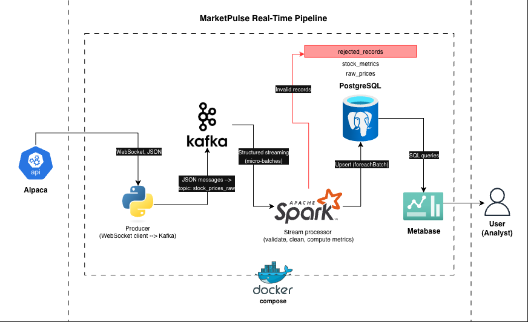

# MarketPulse Real-Time Stock Pipeline

[](https://github.com/ngozi-nnajim/marketpulse-pipeline/actions/workflows/ci.yml)

A real-time data pipeline that streams live stock and crypto market data from
Alpaca through Apache Kafka, validates and aggregates it with Spark Structured
Streaming, stores it in PostgreSQL, and visualises it in a live Metabase
dashboard. The whole stack runs locally with Docker Compose.

Built for **MarketPulse Analytics**, a fintech firm whose existing pipeline
struggles with latency, scalability, and monitoring during peak market periods.

## Architecture



| Component | Role |
|---|---|
| **Alpaca Market Data API** | Source: real-time one-minute bars over WebSocket (IEX feed for stocks, US feed for crypto) |
| **Producer** (Python) | Receives bars, adds metadata, publishes JSON to Kafka keyed by symbol |
| **Apache Kafka** | Durable, replayable event log that decouples ingestion from processing and buffers traffic spikes |
| **Spark Structured Streaming** | Validates every message, routes bad data to a rejection table, computes 5-minute window metrics |
| **PostgreSQL** | Analytical storage: clean bars, window metrics, rejected records |
| **Metabase** | Live dashboard for market insights and pipeline health |
| **Kafka UI / Spark UI** | Operational monitoring of topics, consumers, and streaming throughput |

Key design decisions are recorded in [`docs/adr/`](docs/adr/).

## How the data flows

1. The producer keeps a WebSocket open to Alpaca. Every minute, it receives one
   bar per symbol and publishes it to the `stock_prices_raw` topic, using the
   symbol as the key, so each symbol's bars stay in order within one partition.
2. Spark reads the topic in 10-second micro-batches, parses each message
   against the expected schema, and applies validation rules.
3. Valid bars are upserted into `raw_prices`. Invalid messages go to
   `rejected_records` with the reason and the original payload.
4. A second streaming query aggregates valid bars into 5-minute windows
   (with a 2-minute watermark for late data) and writes `stock_metrics`.
5. Metabase queries PostgreSQL and auto-refreshes every minute.

### Message contract (schema version 1)

```json
{
  "schema_version": 1,
  "symbol": "AAPL",
  "asset_class": "stock",
  "bar_timestamp": "2026-10-19T14:30:00+00:00",
  "open": 344.10, "high": 344.25, "low": 343.98, "close": 344.19,
  "volume": 12086, "trade_count": 285, "vwap": 344.12,
  "ingested_at": "2026-10-19T14:31:00.632123+00:00"
}
```

`bar_timestamp` marks the **start** of the one-minute bar. All times are UTC.

### Data quality rules

| Rule | Rejection reason |
|---|---|
| Unparseable JSON or missing symbol | `malformed_or_missing_symbol` |
| Unknown schema version | `unsupported_schema_version` |
| Asset class not `stock` or `crypto` | `invalid_asset_class` |
| Unparseable timestamp | `invalid_bar_timestamp` |
| Any price missing or ≤ 0 | `missing_or_non_positive_price` |
| `high` below `low` | `high_below_low` |
| `open` or `close` outside the high/low range | `open_or_close_outside_high_low` |
| Volume missing or negative | `invalid_volume` |
| Trade count missing, negative, or fractional | `invalid_trade_count` |

Zero volume is deliberately **valid**: thin crypto markets often have minutes
with prices but no trades.

## Getting started

### Prerequisites

- Docker Desktop, with at least 6 GB of memory allocated
- A free [Alpaca](https://alpaca.markets) paper-trading account and API keys
- [uv](https://docs.astral.sh/uv/) (only needed for local development and tests)

### Run the pipeline

```bash
git clone https://github.com/<your-username>/marketpulse-pipeline.git

cd marketpulse-pipeline

cp .env.example .env        # then fill in your Alpaca keys and other values

docker compose up -d --build
```

The first start takes a few minutes while images download.

| Service | URL |
|---|---|
| Metabase dashboard | http://localhost:3001 |
| Kafka UI | http://localhost:8080 |
| Spark UI | http://localhost:4040 |

US stocks only stream during market hours (13:30 to 20:00 UTC on weekdays).
Crypto streams 24/7, so the pipeline always has data to show.

### Check that data is flowing

```bash
docker compose exec postgres psql -U marketpulse -d marketpulse -c \
  "SELECT symbol, bar_timestamp, close FROM raw_prices ORDER BY bar_timestamp DESC LIMIT 10;"
```

### Restore the saved dashboard

```bash
docker compose exec -T postgres psql -U marketpulse -d metabase_app < metabase/metabase_app.sql
docker compose restart metabase
```

The backup's database connection is encrypted with the original
`MB_ENCRYPTION_SECRET_KEY`. With a different key, the dashboards still
restore, but you'll need to re-enter the PostgreSQL connection in Metabase's
admin settings (host `postgres`, port `5432`, database `marketpulse`).

## Development

```bash
uv sync                          # Install dependencies from uv.lock
uv run pre-commit install        # Enable git hooks (Ruff, Gitleaks, file checks)
uv run pytest -v                 # Producer unit tests
```

Spark tests run inside the Spark image, so they use exactly the same Python,
Java, and Spark versions as production:

```bash
docker build --target test -f docker/spark.Dockerfile -t marketpulse-spark-test .
docker run --rm marketpulse-spark-test
```

CI (GitHub Actions) runs the pre-commit hooks, both test suites, and a
producer image build on every push and pull request.

## Project structure

```
marketpulse-pipeline/
├── .github/workflows/ci.yml        # CI pipeline
├── docker/
│   ├── producer.Dockerfile
│   └── spark.Dockerfile            # Multi-stage: test and runtime
├── docs/
│   ├── adr/                        # Architecture decision records
│   ├── architecture.drawio         # Editable diagram source
│   └── architecture.png
├── metabase/metabase_app.sql       # Dashboard backup
├── scripts/explore_alpaca.py       # Initial API exploration
├── sql/
│   ├── init.sql                    # Pipeline schema
│   ├── 02_metabase.sql             # Metabase app database
│   └── dashboard_queries.sql       # Dashboard SQL, version-controlled
├── src/marketpulse/
│   ├── config.py                   # Typed settings (pydantic-settings)
│   ├── producer/                   # Alpaca -> Kafka
│   └── processing/                 # Kafka -> Spark -> PostgreSQL
├── tests/
│   ├── producer/
│   └── processing/
├── docker-compose.yml
└── pyproject.toml
```

## Known limitations

These are deliberate simplifications for a local project, with the
production alternative for each:

- **Partial market volume:** the free Alpaca plan covers only the IEX
  exchange. Production would use the full consolidated (SIP) feed.
- **Single-node Kafka without persistence:** messages are lost if the Kafka
  container is removed. Production would run a replicated, multi-broker cluster.
- **Spark local mode:** one container. Production would run on a cluster
  (Kubernetes or a managed platform such as Databricks).
- **Rejected records can duplicate on replay**, since they have no natural key.
- **"% change today"** is measured from the first bar of the UTC day, not the
  previous day's official close.

## Future improvements

- Stream individual trades and build bars in Spark, for sub-second latency
- Add Alpaca's real-time news stream for sentiment analysis
- Metrics and alerting with Prometheus and Grafana
- A schema registry with Avro or Protobuf for enforced message contracts
- Price forecasting and anomaly detection on the stored history
